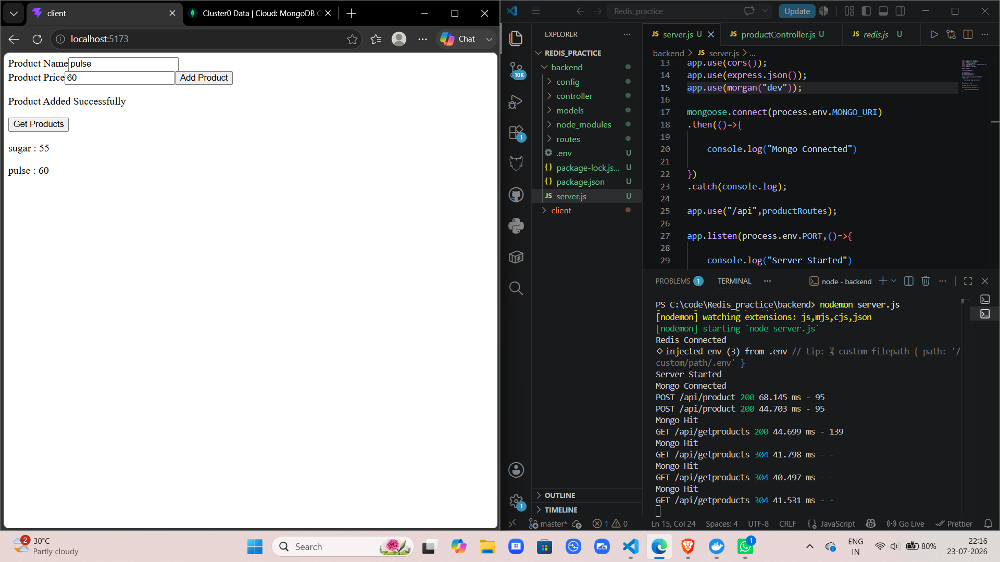
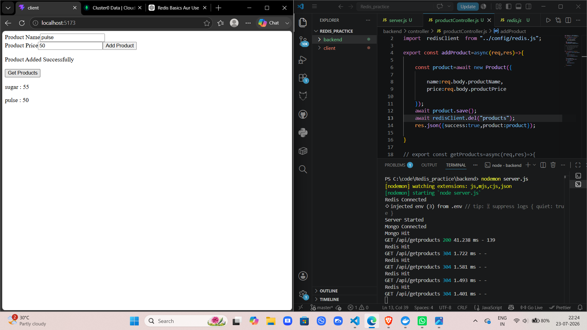

# Redis Practice Project

Ye project Node.js, Express, Redis aur React ka simple full-stack practice app hai.

# Without redis we can see that they take more than time because data come from mongodb

# with redis the take less time because data come from cache

## Project Overview

Is project me aap Redis ke saath backend aur frontend ko integrate karke basic data flow samajh sakte ho. Iska main focus practice aur learning hai.

## Project Structure

- Backend: Node.js aur Express server
- Frontend: React + Vite client
- Database/Cache: Redis

## Features

- Basic CRUD practice
- Redis integration for caching and learning
- Simple frontend to interact with backend

## Setup

1. Backend folder me dependencies install karo
2. Client folder me dependencies install karo
3. Dono services ko alag-alag run karo

## Git Ignore

Project root par ek .gitignore file di gayi hai, jisse node_modules, environment files, logs aur build files version control me na aaye.

## Notes

Is project ka use learning aur practice ke liye kiya gaya hai. Agar aap chaho to isko aur improve karke full application banaya ja sakta hai.
